# Git and Github Masterclass — Learner Guide

**Course Code:** C171  |  **Version:** v3.0  |  **Release date:** 4 October 2026

## Course learning outcomes

- LO1: Analyze GitHub components and coordinate release scheduling with collaborators to align processes.
- LO2: Select appropriate Git scripts for integrating and deploying software products.
- LO3: Configure software products and deploy releases using Git configuration tests.
- LO4: Diagnose issues identified during GitHub configuration testing by interpreting configuration test results.
- LO5: Identify potential improvements to software configuration, deployment processes, and code elements.
- LO6: Implement modifications to software products and processes for improved functionality.

## GH-900 exam blueprint

Exam blueprint current as of January 2026; Microsoft Learn page updated 19 February 2026.

- **Domain 01 — Understand Git and GitHub Basics (25–30%)**: Version control · Git areas and states · commands · accounts · GitHub Flow · Markdown
- **Domain 02 — Work with GitHub Repositories (10–15%)**: Repository structure · templates · files · branches · insights
- **Domain 03 — Collaborate Using GitHub (10–15%)**: Issues · pull requests · discussions · notifications · Pages
- **Domain 04 — Apply Modern Development Practices (10–15%)**: Actions · Copilot · Codespaces · dev containers · github.dev
- **Domain 05 — Manage Projects with GitHub (5–10%)**: Projects · views · fields · workflows · milestones · insights
- **Domain 06 — Understand Privacy, Security and Administration (10–15%)**: 2FA · passkeys · roles · visibility · rulesets · EMU · policy
- **Domain 07 — Explore the GitHub Community (5–10%)**: Open source · Sponsors · Marketplace · InnerSource · discovery

## Source and safety notes

This guide uses the current Microsoft Learn GH-900 study guide, official Git and GitHub documentation, the supplied tertiarycourses/githubtutorial repository, W3Schools Git tutorial, GitHub Learn, GitHub Education resources, the approved course page, and useful coverage retained from the previous 458-slide deck. GitHub interfaces change; use feature names and purpose as the stable reference.

Never place passwords, personal access tokens, SSH private keys, recovery codes, API keys, or real secrets in a repository, screenshot, or Excel workbook.

## Git command reference

Use this cycle: inspect first, change deliberately, verify the next snapshot, then publish. Angle-bracket values are placeholders; replace them without typing the brackets. The same commands are printed on the two-page Git Command Cheatsheet PDF and summarised in the Git Command Cheat Sheet appendix of the slide deck.

### Setup and snapshot

Install, identify yourself, start a repository and record snapshots.

| Command | Purpose |
|---|---|
| `git --version` | Verify that Git is installed and available. |
| `git config --global user.name "Your Name"` | Set the author name used in new commits. |
| `git config --global user.email "you@example.com"` | Set the author email used in new commits. |
| `git config --global init.defaultBranch main` | Make main the initial branch of new repositories. |
| `git init` | Create a new local Git repository in the current folder. |
| `git clone <url>` | Copy a remote repository and configure origin. |
| `git status -sb` | Show the branch plus concise working-tree and staging state. |
| `git diff` | Inspect unstaged changes before selecting them. |
| `git add <file>` | Stage a named file for the next commit. |
| `git add -p` | Select individual change hunks to stage. |
| `git diff --staged` | Review exactly what the next commit will contain. |
| `git commit -m "Message"` | Create a local snapshot with an outcome-based message. |
| `git commit --amend` | Rewrite the most recent commit; only before it is shared. |
| `git rm --cached <file>` | Stop tracking a file that .gitignore cannot hide retroactively. |

### Inspect and investigate

Read history, objects and line-level authorship.

| Command | Purpose |
|---|---|
| `git log --oneline --graph --all --decorate` | Read compact history, branches and pointers. |
| `git log --since="2 weeks" --author=<name>` | Filter history by time window and author. |
| `git log -- <path>` | Show only the commits that touched one path. |
| `git log -S"<text>"` | Find commits that added or removed a string. |
| `git show HEAD` | Inspect the latest commit and its patch. |
| `git cat-file -p <sha>` | Print a raw blob, tree, commit or tag object. |
| `git blame <file>` | Show which commit and author last changed each line. |
| `git diff <a>..<b>` | Compare any two commits, branches or tags. |

### Branch, merge and rebase

Isolate work and integrate it with the right strategy.

| Command | Purpose |
|---|---|
| `git branch` | List local branches and identify the current branch. |
| `git switch -c <branch>` | Create and switch to a focused branch. |
| `git switch main` | Return to the main branch. |
| `git switch -` | Jump back to the previously checked-out branch. |
| `git merge <branch>` | Integrate a completed branch into the current branch. |
| `git merge --no-ff <branch>` | Force a merge commit so the branch remains visible. |
| `git rebase main` | Replay local commits on top of main; never on shared history. |
| `git rebase --abort` | Cancel an in-progress rebase and restore the prior state. |
| `git cherry-pick <commit>` | Copy one commit onto the current branch. |
| `git branch -d <branch>` | Delete a branch only after Git confirms it is merged. |

### Sync and remote

Move history between the local repository and GitHub.

| Command | Purpose |
|---|---|
| `git remote -v` | Inspect remote fetch and push endpoints. |
| `git remote add upstream <url>` | Register the source repository of a fork. |
| `git fetch origin` | Update remote-tracking references without changing working files. |
| `git branch -vv` | Inspect upstream tracking plus ahead/behind information. |
| `git log HEAD..origin/main --oneline` | List incoming commits before integrating them. |
| `git pull --ff-only origin main` | Fetch and fast-forward without creating an unexpected merge commit. |
| `git push -u origin <branch>` | Publish a branch and establish its upstream. |
| `git push origin --tags` | Publish annotated tags so releases are visible on GitHub. |

### Tag, stash and release

Mark releases and park work in progress.

| Command | Purpose |
|---|---|
| `git tag` | List the tags that already exist in the repository. |
| `git tag -a v1.0.0 -m "Release 1.0.0"` | Create an annotated tag with author, date and message. |
| `git tag v1.0.0-light` | Create a lightweight tag: a bare pointer with no metadata. |
| `git show v1.0.0` | Inspect the tag object and the commit it marks. |
| `git stash push -m "wip"` | Park uncommitted work and return to a clean tree. |
| `git stash list` | List parked stash entries in order. |
| `git stash pop` | Reapply the newest stash and drop it from the list. |
| `git stash apply stash@{1}` | Reapply an older stash while keeping it stored. |

### Undo and rescue

Choose the safe undo for the state and sharing status.

| Command | Purpose |
|---|---|
| `git restore <file>` | Discard an unstaged local change to a file. |
| `git restore --staged <file>` | Unstage a file while keeping its working-tree edits. |
| `git reset --soft <commit>` | Move HEAD only; keep the index and working tree. |
| `git reset --mixed <commit>` | Move HEAD and reset the index; keep the working tree. |
| `git reset --hard <commit>` | Move HEAD, index and working tree; discards work. |
| `git revert <commit>` | Create a new commit that safely reverses shared history. |
| `git reflog` | List where HEAD has been, so lost commits can be recovered. |
| `git switch -c rescue <sha-from-reflog>` | Recover a detached or reset commit onto a new branch. |

## Domain 01 — Understand Git and GitHub Basics (25–30%)

Version control · Git areas and states · commands · accounts · GitHub Flow · Markdown

### Core concepts

- **Version control:** History, traceability, rollback and safe parallel work.
- **Git vs GitHub:** Distributed version control locally; collaboration platform in the cloud.
- **Core objects:** Repository, working tree, staging area, commit, branch, HEAD, remote and tag.
- **GitHub Flow:** Branch → commit → pull request → review → merge → deploy.
- **Account choices:** Personal accounts, organisations and enterprises solve different governance needs.
- **Command literacy:** status, diff, add, commit and log turn file changes into deliberate snapshots.

### Lab 01 — Install Git, Git Bash and GitHub Desktop

**Objective:** Prepare and verify a safe local Git toolchain before working with repositories.

**Scenario:** Northstar Learning is onboarding a new contributor on Windows or macOS and needs a repeatable setup record.

**Deliverable:** A verified Git/Git Bash and GitHub Desktop installation with identity and default-branch configuration

**Tools:** https://git-scm.com/install/, https://desktop.github.com/download/, Git Bash or terminal, Excel evidence workbook

#### Lab workflow

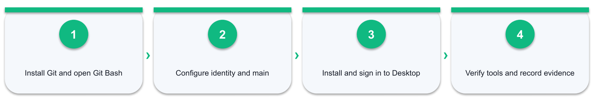

*Figure 1: Lab 01 workflow — Install Git and open Git Bash → Configure identity and main → Install and sign in to Desktop → Verify tools and record evidence*

#### Detailed procedure

1. **Action:** Open https://git-scm.com/install/, select the operating system and download the current installer or follow the platform installation method.
   - **Why:** This action produces traceable evidence for the scenario and the mapped GH-900 objective.
   - **Record:** Enter the result, URL or screenshot reference, completion status, timestamp, and any reviewer note in row 5 of the Excel Evidence Log.
2. **Action:** On Windows, complete the Git for Windows installation and confirm that Git Bash is available from the Start menu; on macOS or Linux, open the installed terminal environment.
   - **Why:** This action produces traceable evidence for the scenario and the mapped GH-900 objective.
   - **Record:** Enter the result, URL or screenshot reference, completion status, timestamp, and any reviewer note in row 6 of the Excel Evidence Log.
3. **Action:** Open Git Bash or a terminal and run git --version; record the exact version and terminal name in Excel.
   - **Why:** This action produces traceable evidence for the scenario and the mapped GH-900 objective.
   - **Record:** Enter the result, URL or screenshot reference, completion status, timestamp, and any reviewer note in row 7 of the Excel Evidence Log.
4. **Action:** Open https://desktop.github.com/download/, choose the correct Windows or macOS installer and install GitHub Desktop.
   - **Why:** This action produces traceable evidence for the scenario and the mapped GH-900 objective.
   - **Record:** Enter the result, URL or screenshot reference, completion status, timestamp, and any reviewer note in row 8 of the Excel Evidence Log.
5. **Action:** Launch GitHub Desktop, sign in to the training GitHub account and confirm the configured Git executable and preferred editor.
   - **Why:** This action produces traceable evidence for the scenario and the mapped GH-900 objective.
   - **Record:** Enter the result, URL or screenshot reference, completion status, timestamp, and any reviewer note in row 9 of the Excel Evidence Log.
6. **Action:** Configure user.name, a verified or GitHub no-reply user.email, and init.defaultBranch main from Git Bash or the terminal.
   - **Why:** This action produces traceable evidence for the scenario and the mapped GH-900 objective.
   - **Record:** Enter the result, URL or screenshot reference, completion status, timestamp, and any reviewer note in row 10 of the Excel Evidence Log.
7. **Action:** Run git config --list --show-origin and confirm which file supplies the identity and default-branch values.
   - **Why:** This action produces traceable evidence for the scenario and the mapped GH-900 objective.
   - **Record:** Enter the result, URL or screenshot reference, completion status, timestamp, and any reviewer note in row 11 of the Excel Evidence Log.
8. **Action:** Create or sign in to a personal GitHub account and enable 2FA, or record the trainer demonstration where policy prevents account changes.
   - **Why:** This action produces traceable evidence for the scenario and the mapped GH-900 objective.
   - **Record:** Enter the result, URL or screenshot reference, completion status, timestamp, and any reviewer note in row 12 of the Excel Evidence Log.
9. **Action:** Capture the Git version, Git Bash/terminal verification, GitHub Desktop sign-in and configuration evidence in Excel without recording credentials.
   - **Why:** This action produces traceable evidence for the scenario and the mapped GH-900 objective.
   - **Record:** Enter the result, URL or screenshot reference, completion status, timestamp, and any reviewer note in row 13 of the Excel Evidence Log.

#### Acceptance criteria

- [ ] Git version is recorded
- [ ] Git Bash or terminal works
- [ ] GitHub Desktop is signed in
- [ ] Identity and default branch are verified

#### Reflection questions

1. Which GitHub object or control was the best fit, and why?
2. What evidence proves the final state rather than only the attempted action?
3. What would you change for an organisation or enterprise environment?

### Lab 02 — Create and Clone a Training Repository

**Objective:** Create a remote repository and understand how clone establishes a local copy and origin remote.

**Scenario:** The onboarding team needs a safe repository that every later lab can reuse.

**Deliverable:** A public northstar-git-lab repository cloned locally with a verified origin remote

**Tools:** GitHub.com, Git Bash or terminal, GitHub Desktop, Markdown, Excel evidence workbook

#### Lab workflow

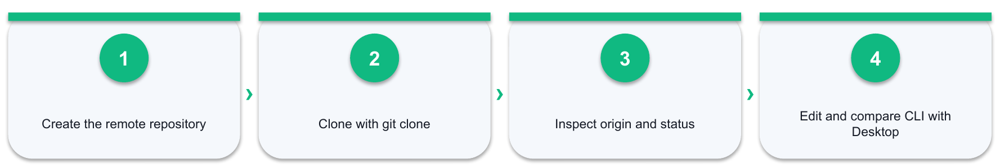

*Figure 2: Lab 02 workflow — Create the remote repository → Clone with git clone → Inspect origin and status → Edit and compare CLI with Desktop*

#### Detailed procedure

1. **Action:** Create a public repository named northstar-git-lab with README.md and an appropriate .gitignore template.
   - **Why:** This action produces traceable evidence for the scenario and the mapped GH-900 objective.
   - **Record:** Enter the result, URL or screenshot reference, completion status, timestamp, and any reviewer note in row 5 of the Excel Evidence Log.
2. **Action:** Copy the HTTPS clone URL and identify the owner, repository name and protocol in the URL.
   - **Why:** This action produces traceable evidence for the scenario and the mapped GH-900 objective.
   - **Record:** Enter the result, URL or screenshot reference, completion status, timestamp, and any reviewer note in row 6 of the Excel Evidence Log.
3. **Action:** In Git Bash or a terminal, choose a training folder and run git clone <repository-url>.
   - **Why:** This action produces traceable evidence for the scenario and the mapped GH-900 objective.
   - **Record:** Enter the result, URL or screenshot reference, completion status, timestamp, and any reviewer note in row 7 of the Excel Evidence Log.
4. **Action:** Enter the cloned folder and run git status -sb to confirm the current branch and clean working tree.
   - **Why:** This action produces traceable evidence for the scenario and the mapped GH-900 objective.
   - **Record:** Enter the result, URL or screenshot reference, completion status, timestamp, and any reviewer note in row 8 of the Excel Evidence Log.
5. **Action:** Run git remote -v and explain why origin normally has both fetch and push URLs.
   - **Why:** This action produces traceable evidence for the scenario and the mapped GH-900 objective.
   - **Record:** Enter the result, URL or screenshot reference, completion status, timestamp, and any reviewer note in row 9 of the Excel Evidence Log.
6. **Action:** Open the same local repository in GitHub Desktop and locate the Current branch, History and Fetch origin controls.
   - **Why:** This action produces traceable evidence for the scenario and the mapped GH-900 objective.
   - **Record:** Enter the result, URL or screenshot reference, completion status, timestamp, and any reviewer note in row 10 of the Excel Evidence Log.
7. **Action:** Edit README.md with a project purpose, prerequisites and task list; save without committing.
   - **Why:** This action produces traceable evidence for the scenario and the mapped GH-900 objective.
   - **Record:** Enter the result, URL or screenshot reference, completion status, timestamp, and any reviewer note in row 11 of the Excel Evidence Log.
8. **Action:** Compare the changed-file view in GitHub Desktop with git status and git diff in Git Bash.
   - **Why:** This action produces traceable evidence for the scenario and the mapped GH-900 objective.
   - **Record:** Enter the result, URL or screenshot reference, completion status, timestamp, and any reviewer note in row 12 of the Excel Evidence Log.
9. **Action:** Record the remote URL, local folder, current branch and observed file state in Excel.
   - **Why:** This action produces traceable evidence for the scenario and the mapped GH-900 objective.
   - **Record:** Enter the result, URL or screenshot reference, completion status, timestamp, and any reviewer note in row 13 of the Excel Evidence Log.

#### Acceptance criteria

- [ ] Remote repository exists
- [ ] Local clone has origin
- [ ] CLI and Desktop show the same change
- [ ] Workbook records paths and states

#### Reflection questions

1. Which GitHub object or control was the best fit, and why?
2. What evidence proves the final state rather than only the attempted action?
3. What would you change for an organisation or enterprise environment?

## Domain 02 — Work with GitHub Repositories (10–15%)

Repository structure · templates · files · branches · insights

### Core concepts

- **Repository health:** README, LICENSE, CONTRIBUTING, CODEOWNERS and SECURITY establish trust.
- **Create and organise:** Templates, branches and clear names make repositories repeatable.
- **Manage files:** init, clone, status, diff, add, commit, log, branch, merge, fetch, pull and push.
- **Visibility:** Insights, traffic, contributors, stars and dependency views reveal health.
- **Maintenance:** Archive, transfer, protect and document repositories deliberately.
- **Feature previews:** Test emerging capabilities without confusing preview with GA.

### Lab 03 — Practice Status, Diff, Add, Commit and Log

**Objective:** Move changes deliberately from working tree to staging area to local history and the remote.

**Scenario:** The repository needs small, reviewable commits rather than one uncontrolled upload.

**Deliverable:** A three-commit repository history with selective staging, clear messages and command evidence

**Tools:** Git Bash or terminal, GitHub Desktop, text editor, GitHub.com, Excel command workbook

#### Lab workflow

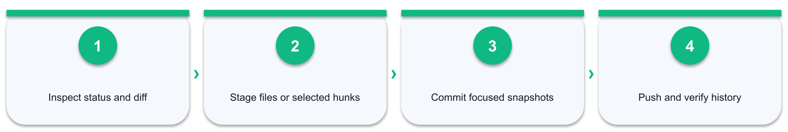

*Figure 3: Lab 03 workflow — Inspect status and diff → Stage files or selected hunks → Commit focused snapshots → Push and verify history*

#### Detailed procedure

1. **Action:** Run git status and classify each file as untracked, modified, staged or unchanged.
   - **Why:** This action produces traceable evidence for the scenario and the mapped GH-900 objective.
   - **Record:** Enter the result, URL or screenshot reference, completion status, timestamp, and any reviewer note in row 5 of the Excel Evidence Log.
2. **Action:** Make two different changes to README.md and create notes.txt so there are multiple changes to inspect.
   - **Why:** This action produces traceable evidence for the scenario and the mapped GH-900 objective.
   - **Record:** Enter the result, URL or screenshot reference, completion status, timestamp, and any reviewer note in row 6 of the Excel Evidence Log.
3. **Action:** Run git diff and explain the plus/minus lines, file headers and unstaged scope.
   - **Why:** This action produces traceable evidence for the scenario and the mapped GH-900 objective.
   - **Record:** Enter the result, URL or screenshot reference, completion status, timestamp, and any reviewer note in row 7 of the Excel Evidence Log.
4. **Action:** Stage only README.md with git add README.md, then run git status again and compare staged versus untracked content.
   - **Why:** This action produces traceable evidence for the scenario and the mapped GH-900 objective.
   - **Record:** Enter the result, URL or screenshot reference, completion status, timestamp, and any reviewer note in row 8 of the Excel Evidence Log.
5. **Action:** Run git diff --staged and verify exactly what the next commit will contain.
   - **Why:** This action produces traceable evidence for the scenario and the mapped GH-900 objective.
   - **Record:** Enter the result, URL or screenshot reference, completion status, timestamp, and any reviewer note in row 9 of the Excel Evidence Log.
6. **Action:** Create a focused commit with git commit -m followed by an outcome-based message.
   - **Why:** This action produces traceable evidence for the scenario and the mapped GH-900 objective.
   - **Record:** Enter the result, URL or screenshot reference, completion status, timestamp, and any reviewer note in row 10 of the Excel Evidence Log.
7. **Action:** Run git cat-file -p HEAD and identify the tree, parent, author and committer lines of the commit object you just created.
   - **Why:** This action produces traceable evidence for the scenario and the mapped GH-900 objective.
   - **Record:** Enter the result, URL or screenshot reference, completion status, timestamp, and any reviewer note in row 11 of the Excel Evidence Log.
8. **Action:** Correct the message of that unshared commit with git commit --amend, then compare the old and new commit IDs and explain why amending after pushing is unsafe.
   - **Why:** This action produces traceable evidence for the scenario and the mapped GH-900 objective.
   - **Record:** Enter the result, URL or screenshot reference, completion status, timestamp, and any reviewer note in row 12 of the Excel Evidence Log.
9. **Action:** Stage notes.txt and use git add -p on a later README change to practise selective hunk staging.
   - **Why:** This action produces traceable evidence for the scenario and the mapped GH-900 objective.
   - **Record:** Enter the result, URL or screenshot reference, completion status, timestamp, and any reviewer note in row 13 of the Excel Evidence Log.
10. **Action:** Start a third unrelated edit, run git stash push -m "wip", confirm with git status that the tree is clean, then inspect git stash list.
   - **Why:** This action produces traceable evidence for the scenario and the mapped GH-900 objective.
   - **Record:** Enter the result, URL or screenshot reference, completion status, timestamp, and any reviewer note in row 14 of the Excel Evidence Log.
11. **Action:** Run git stash pop, verify the parked edit returns to the working tree and record when stashing is preferable to an unfinished commit.
   - **Why:** This action produces traceable evidence for the scenario and the mapped GH-900 objective.
   - **Record:** Enter the result, URL or screenshot reference, completion status, timestamp, and any reviewer note in row 15 of the Excel Evidence Log.
12. **Action:** Create two more focused commits, then inspect them with git log --oneline --graph --decorate and git show HEAD.
   - **Why:** This action produces traceable evidence for the scenario and the mapped GH-900 objective.
   - **Record:** Enter the result, URL or screenshot reference, completion status, timestamp, and any reviewer note in row 16 of the Excel Evidence Log.
13. **Action:** Push the commits and verify the same commit IDs and messages on GitHub and in GitHub Desktop History.
   - **Why:** This action produces traceable evidence for the scenario and the mapped GH-900 objective.
   - **Record:** Enter the result, URL or screenshot reference, completion status, timestamp, and any reviewer note in row 17 of the Excel Evidence Log.
14. **Action:** Complete the Excel command log with actual commands, outputs, resulting states and commit URLs.
   - **Why:** This action produces traceable evidence for the scenario and the mapped GH-900 objective.
   - **Record:** Enter the result, URL or screenshot reference, completion status, timestamp, and any reviewer note in row 18 of the Excel Evidence Log.

#### Acceptance criteria

- [ ] Three focused commits exist
- [ ] Staged content was reviewed
- [ ] Amend and stash effects are evidenced
- [ ] History matches locally and remotely
- [ ] Command log records actual outputs

#### Reflection questions

1. Which GitHub object or control was the best fit, and why?
2. What evidence proves the final state rather than only the attempted action?
3. What would you change for an organisation or enterprise environment?

### Lab 04 — Create Branches and Merge Changes

**Objective:** Use branch pointers to isolate work and merge a completed change into main.

**Scenario:** A navigation improvement must be developed without destabilising the main branch.

**Deliverable:** A feature branch, separate commit history, local merge, annotated release tag and readable commit graph

**Tools:** Git Bash or terminal, GitHub Desktop branch visualisation, GitHub Releases, Excel evidence workbook

#### Lab workflow

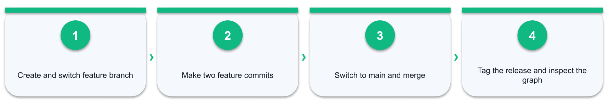

*Figure 4: Lab 04 workflow — Create and switch feature branch → Make two feature commits → Switch to main and merge → Tag the release and inspect the graph*

#### Detailed procedure

1. **Action:** Run git branch and identify the current branch marker and the relationship between HEAD and the branch name.
   - **Why:** This action produces traceable evidence for the scenario and the mapped GH-900 objective.
   - **Record:** Enter the result, URL or screenshot reference, completion status, timestamp, and any reviewer note in row 5 of the Excel Evidence Log.
2. **Action:** Create and switch to feature/navigation with git switch -c feature/navigation.
   - **Why:** This action produces traceable evidence for the scenario and the mapped GH-900 objective.
   - **Record:** Enter the result, URL or screenshot reference, completion status, timestamp, and any reviewer note in row 6 of the Excel Evidence Log.
3. **Action:** Add a Navigation section to README.md, inspect the diff, stage it and commit it on the feature branch.
   - **Why:** This action produces traceable evidence for the scenario and the mapped GH-900 objective.
   - **Record:** Enter the result, URL or screenshot reference, completion status, timestamp, and any reviewer note in row 7 of the Excel Evidence Log.
4. **Action:** Create a second feature commit so the branch has a visible line of development.
   - **Why:** This action produces traceable evidence for the scenario and the mapped GH-900 objective.
   - **Record:** Enter the result, URL or screenshot reference, completion status, timestamp, and any reviewer note in row 8 of the Excel Evidence Log.
5. **Action:** Run git log --oneline --graph --all --decorate and interpret the HEAD, main and feature pointers.
   - **Why:** This action produces traceable evidence for the scenario and the mapped GH-900 objective.
   - **Record:** Enter the result, URL or screenshot reference, completion status, timestamp, and any reviewer note in row 9 of the Excel Evidence Log.
6. **Action:** Switch to main and verify that the feature content is not yet present.
   - **Why:** This action produces traceable evidence for the scenario and the mapped GH-900 objective.
   - **Record:** Enter the result, URL or screenshot reference, completion status, timestamp, and any reviewer note in row 10 of the Excel Evidence Log.
7. **Action:** Merge feature/navigation into main and classify the result as fast-forward or a merge commit from the output and graph.
   - **Why:** This action produces traceable evidence for the scenario and the mapped GH-900 objective.
   - **Record:** Enter the result, URL or screenshot reference, completion status, timestamp, and any reviewer note in row 11 of the Excel Evidence Log.
8. **Action:** Read the merge output and write down what git rebase main would have produced instead, and why rebasing a branch that teammates have already pulled would rewrite shared history.
   - **Why:** This action produces traceable evidence for the scenario and the mapped GH-900 objective.
   - **Record:** Enter the result, URL or screenshot reference, completion status, timestamp, and any reviewer note in row 12 of the Excel Evidence Log.
9. **Action:** Create an annotated release tag with git tag -a v1.0.0 -m "Release 1.0.0", then run git show v1.0.0 and identify the tagger, date and message that a lightweight tag would not carry.
   - **Why:** This action produces traceable evidence for the scenario and the mapped GH-900 objective.
   - **Record:** Enter the result, URL or screenshot reference, completion status, timestamp, and any reviewer note in row 13 of the Excel Evidence Log.
10. **Action:** Delete the merged local feature branch with git branch -d feature/navigation.
   - **Why:** This action produces traceable evidence for the scenario and the mapped GH-900 objective.
   - **Record:** Enter the result, URL or screenshot reference, completion status, timestamp, and any reviewer note in row 14 of the Excel Evidence Log.
11. **Action:** Push main and the tag with git push origin --tags, then open the tag on GitHub and draft a release from it.
   - **Why:** This action produces traceable evidence for the scenario and the mapped GH-900 objective.
   - **Record:** Enter the result, URL or screenshot reference, completion status, timestamp, and any reviewer note in row 15 of the Excel Evidence Log.
12. **Action:** Compare the graph in GitHub Desktop History and record branch, merge, rebase-decision and tag evidence in Excel.
   - **Why:** This action produces traceable evidence for the scenario and the mapped GH-900 objective.
   - **Record:** Enter the result, URL or screenshot reference, completion status, timestamp, and any reviewer note in row 16 of the Excel Evidence Log.

#### Acceptance criteria

- [ ] Feature work is isolated
- [ ] Merge result is explained
- [ ] Rebase safety rule is recorded
- [ ] Annotated tag exists locally and on GitHub
- [ ] Merged branch is safely deleted

#### Reflection questions

1. Which GitHub object or control was the best fit, and why?
2. What evidence proves the final state rather than only the attempted action?
3. What would you change for an organisation or enterprise environment?

### Lab 05 — Synchronise with Fetch, Pull and Push

**Objective:** Distinguish remote-tracking updates from working-branch integration and outbound publication.

**Scenario:** A teammate changed the remote README while the learner was working locally.

**Deliverable:** A synchronised local and remote repository with tracking-branch evidence

**Tools:** Git Bash or terminal, GitHub.com, GitHub Desktop Fetch/Pull/Push controls, Excel workbook

#### Lab workflow

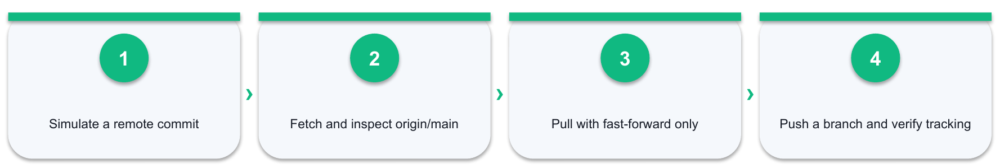

*Figure 5: Lab 05 workflow — Simulate a remote commit → Fetch and inspect origin/main → Pull with fast-forward only → Push a branch and verify tracking*

#### Detailed procedure

1. **Action:** Run git remote -v and git branch -vv; identify origin, the current branch and its upstream tracking branch.
   - **Why:** This action produces traceable evidence for the scenario and the mapped GH-900 objective.
   - **Record:** Enter the result, URL or screenshot reference, completion status, timestamp, and any reviewer note in row 5 of the Excel Evidence Log.
2. **Action:** Edit README.md directly on GitHub to simulate a teammate commit and record its remote commit ID.
   - **Why:** This action produces traceable evidence for the scenario and the mapped GH-900 objective.
   - **Record:** Enter the result, URL or screenshot reference, completion status, timestamp, and any reviewer note in row 6 of the Excel Evidence Log.
3. **Action:** Run git fetch origin and explain why the working files do not change even though origin/main advances.
   - **Why:** This action produces traceable evidence for the scenario and the mapped GH-900 objective.
   - **Record:** Enter the result, URL or screenshot reference, completion status, timestamp, and any reviewer note in row 7 of the Excel Evidence Log.
4. **Action:** Use git log HEAD..origin/main --oneline and git diff HEAD..origin/main to inspect the incoming commit before integration.
   - **Why:** This action produces traceable evidence for the scenario and the mapped GH-900 objective.
   - **Record:** Enter the result, URL or screenshot reference, completion status, timestamp, and any reviewer note in row 8 of the Excel Evidence Log.
5. **Action:** Run git pull --ff-only origin main and confirm the working branch advances without an unexpected merge commit.
   - **Why:** This action produces traceable evidence for the scenario and the mapped GH-900 objective.
   - **Record:** Enter the result, URL or screenshot reference, completion status, timestamp, and any reviewer note in row 9 of the Excel Evidence Log.
6. **Action:** Create a new local branch, make and commit one change, then push it with git push -u origin <branch-name>.
   - **Why:** This action produces traceable evidence for the scenario and the mapped GH-900 objective.
   - **Record:** Enter the result, URL or screenshot reference, completion status, timestamp, and any reviewer note in row 10 of the Excel Evidence Log.
7. **Action:** Run git branch -vv again and explain the new upstream relationship and ahead/behind indicators.
   - **Why:** This action produces traceable evidence for the scenario and the mapped GH-900 objective.
   - **Record:** Enter the result, URL or screenshot reference, completion status, timestamp, and any reviewer note in row 11 of the Excel Evidence Log.
8. **Action:** Use GitHub Desktop to Fetch origin, inspect History and compare the GUI state with git status -sb.
   - **Why:** This action produces traceable evidence for the scenario and the mapped GH-900 objective.
   - **Record:** Enter the result, URL or screenshot reference, completion status, timestamp, and any reviewer note in row 12 of the Excel Evidence Log.
9. **Action:** Record fetch, pull and push effects separately in the Excel command/decision log.
   - **Why:** This action produces traceable evidence for the scenario and the mapped GH-900 objective.
   - **Record:** Enter the result, URL or screenshot reference, completion status, timestamp, and any reviewer note in row 13 of the Excel Evidence Log.

#### Acceptance criteria

- [ ] Fetch is distinguished from pull
- [ ] Incoming commit is inspected
- [ ] Upstream tracking is verified
- [ ] Local and remote histories match

#### Reflection questions

1. Which GitHub object or control was the best fit, and why?
2. What evidence proves the final state rather than only the attempted action?
3. What would you change for an organisation or enterprise environment?

### Lab 06 — Resolve a Merge Conflict and Recover Safely

**Objective:** Diagnose conflict markers, complete a merge and choose a safe recovery command for common mistakes.

**Scenario:** Two contributors changed the same README sentence and Git cannot decide which version to keep.

**Deliverable:** A resolved merge conflict plus a tested restore, unstage, reset, revert and reflog recovery decision record

**Tools:** Git Bash or terminal, GitHub.com, GitHub Desktop conflict helper, text editor, Excel workbook

#### Lab workflow

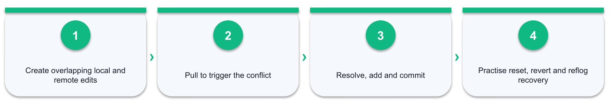

*Figure 6: Lab 06 workflow — Create overlapping local and remote edits → Pull to trigger the conflict → Resolve, add and commit → Practise reset, revert and reflog recovery*

#### Detailed procedure

1. **Action:** Change one selected README sentence locally but do not push it yet.
   - **Why:** This action produces traceable evidence for the scenario and the mapped GH-900 objective.
   - **Record:** Enter the result, URL or screenshot reference, completion status, timestamp, and any reviewer note in row 5 of the Excel Evidence Log.
2. **Action:** Change the same sentence differently on GitHub and commit the remote edit.
   - **Why:** This action produces traceable evidence for the scenario and the mapped GH-900 objective.
   - **Record:** Enter the result, URL or screenshot reference, completion status, timestamp, and any reviewer note in row 6 of the Excel Evidence Log.
3. **Action:** Commit the local version, then run git pull and observe the conflict message without using a destructive reset.
   - **Why:** This action produces traceable evidence for the scenario and the mapped GH-900 objective.
   - **Record:** Enter the result, URL or screenshot reference, completion status, timestamp, and any reviewer note in row 7 of the Excel Evidence Log.
4. **Action:** Run git status and identify the unmerged path and the merge currently in progress.
   - **Why:** This action produces traceable evidence for the scenario and the mapped GH-900 objective.
   - **Record:** Enter the result, URL or screenshot reference, completion status, timestamp, and any reviewer note in row 8 of the Excel Evidence Log.
5. **Action:** Open README.md, locate the conflict markers and explain the current, separator and incoming sections.
   - **Why:** This action produces traceable evidence for the scenario and the mapped GH-900 objective.
   - **Record:** Enter the result, URL or screenshot reference, completion status, timestamp, and any reviewer note in row 9 of the Excel Evidence Log.
6. **Action:** Resolve the sentence deliberately, remove all markers, stage README.md and complete the merge commit.
   - **Why:** This action produces traceable evidence for the scenario and the mapped GH-900 objective.
   - **Record:** Enter the result, URL or screenshot reference, completion status, timestamp, and any reviewer note in row 10 of the Excel Evidence Log.
7. **Action:** Push the resolved history and verify both original commits plus the resolution in the graph.
   - **Why:** This action produces traceable evidence for the scenario and the mapped GH-900 objective.
   - **Record:** Enter the result, URL or screenshot reference, completion status, timestamp, and any reviewer note in row 11 of the Excel Evidence Log.
8. **Action:** Create a harmless unstaged edit and practise git restore; stage another harmless edit and practise git restore --staged.
   - **Why:** This action produces traceable evidence for the scenario and the mapped GH-900 objective.
   - **Record:** Enter the result, URL or screenshot reference, completion status, timestamp, and any reviewer note in row 12 of the Excel Evidence Log.
9. **Action:** On a throwaway branch, make one local commit and undo it with git reset --soft HEAD~1; run git status and record that the change is still staged.
   - **Why:** This action produces traceable evidence for the scenario and the mapped GH-900 objective.
   - **Record:** Enter the result, URL or screenshot reference, completion status, timestamp, and any reviewer note in row 13 of the Excel Evidence Log.
10. **Action:** Recommit it, then run git reset --hard HEAD~1 on that same throwaway branch and record that both the commit and the working-tree change are gone.
   - **Why:** This action produces traceable evidence for the scenario and the mapped GH-900 objective.
   - **Record:** Enter the result, URL or screenshot reference, completion status, timestamp, and any reviewer note in row 14 of the Excel Evidence Log.
11. **Action:** Run git reflog, locate the SHA of the commit you just discarded, and recover it with git switch -c rescue <sha>; confirm the content is back.
   - **Why:** This action produces traceable evidence for the scenario and the mapped GH-900 objective.
   - **Record:** Enter the result, URL or screenshot reference, completion status, timestamp, and any reviewer note in row 15 of the Excel Evidence Log.
12. **Action:** Create and push a harmless commit on main, then reverse it safely with git revert <commit> and push the revert.
   - **Why:** This action produces traceable evidence for the scenario and the mapped GH-900 objective.
   - **Record:** Enter the result, URL or screenshot reference, completion status, timestamp, and any reviewer note in row 16 of the Excel Evidence Log.
13. **Action:** Record the conflict cause, resolution decision and a comparison of restore, restore --staged, reset --soft, reset --hard, revert and reflog by the state each one changes and whether the history was shared.
   - **Why:** This action produces traceable evidence for the scenario and the mapped GH-900 objective.
   - **Record:** Enter the result, URL or screenshot reference, completion status, timestamp, and any reviewer note in row 17 of the Excel Evidence Log.

#### Acceptance criteria

- [ ] Conflict markers are removed
- [ ] Merge completes without lost history
- [ ] Reset variants are distinguished by effect
- [ ] A discarded commit is recovered via reflog
- [ ] Resolution and revert are evidenced

#### Reflection questions

1. Which GitHub object or control was the best fit, and why?
2. What evidence proves the final state rather than only the attempted action?
3. What would you change for an organisation or enterprise environment?

## Domain 03 — Collaborate Using GitHub (10–15%)

Issues · pull requests · discussions · notifications · Pages

### Core concepts

- **Choose the right object:** Issue for tracked work, discussion for conversation, PR for proposed change.
- **Traceability:** Closing keywords link PRs to issues and preserve decision context.
- **Review:** Comments, suggestions, approvals and required reviewers protect quality.
- **Triage:** Labels, assignments, filters, templates and notifications keep work actionable.
- **Share knowledge:** Gists, Wikis and Pages publish snippets, documentation and sites.
- **Fork workflow:** Fork, branch, change and upstream PR enable external contribution.

### Lab 07 — Open a Pull Request and Complete Code Review

**Objective:** Connect command-line branch work to a traceable pull request, review and merge.

**Scenario:** A learner onboarding checklist requires peer review and issue traceability before release.

**Deliverable:** A linked issue, pushed branch, reviewed pull request, controlled merge and local clean-up

**Tools:** Git Bash, GitHub pull requests, GitHub Desktop, Excel evidence workbook

#### Lab workflow

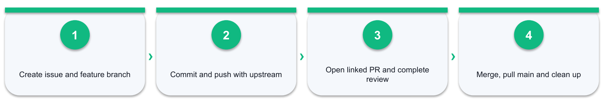

*Figure 7: Lab 07 workflow — Create issue and feature branch → Commit and push with upstream → Open linked PR and complete review → Merge, pull main and clean up*

#### Detailed procedure

1. **Action:** Create an issue describing the onboarding-checklist improvement and its acceptance criteria.
   - **Why:** This action produces traceable evidence for the scenario and the mapped GH-900 objective.
   - **Record:** Enter the result, URL or screenshot reference, completion status, timestamp, and any reviewer note in row 5 of the Excel Evidence Log.
2. **Action:** Create feat/onboarding-checklist, make a focused change and commit it after reviewing git diff --staged.
   - **Why:** This action produces traceable evidence for the scenario and the mapped GH-900 objective.
   - **Record:** Enter the result, URL or screenshot reference, completion status, timestamp, and any reviewer note in row 6 of the Excel Evidence Log.
3. **Action:** Push the branch with -u and verify the upstream tracking relationship.
   - **Why:** This action produces traceable evidence for the scenario and the mapped GH-900 objective.
   - **Record:** Enter the result, URL or screenshot reference, completion status, timestamp, and any reviewer note in row 7 of the Excel Evidence Log.
4. **Action:** Open a pull request whose body uses Closes #<issue-number> and explains verification evidence.
   - **Why:** This action produces traceable evidence for the scenario and the mapped GH-900 objective.
   - **Record:** Enter the result, URL or screenshot reference, completion status, timestamp, and any reviewer note in row 8 of the Excel Evidence Log.
5. **Action:** Inspect the Commits, Checks and Files changed views; request a review and leave one constructive comment.
   - **Why:** This action produces traceable evidence for the scenario and the mapped GH-900 objective.
   - **Record:** Enter the result, URL or screenshot reference, completion status, timestamp, and any reviewer note in row 9 of the Excel Evidence Log.
6. **Action:** Apply the feedback in a new local commit and push it; verify the existing pull request updates automatically.
   - **Why:** This action produces traceable evidence for the scenario and the mapped GH-900 objective.
   - **Record:** Enter the result, URL or screenshot reference, completion status, timestamp, and any reviewer note in row 10 of the Excel Evidence Log.
7. **Action:** Merge only after review/check expectations pass, then delete the remote branch.
   - **Why:** This action produces traceable evidence for the scenario and the mapped GH-900 objective.
   - **Record:** Enter the result, URL or screenshot reference, completion status, timestamp, and any reviewer note in row 11 of the Excel Evidence Log.
8. **Action:** Switch to main locally, pull with --ff-only, verify the linked issue closed and delete the local branch.
   - **Why:** This action produces traceable evidence for the scenario and the mapped GH-900 objective.
   - **Record:** Enter the result, URL or screenshot reference, completion status, timestamp, and any reviewer note in row 12 of the Excel Evidence Log.
9. **Action:** Capture issue, PR, review, check, merge and clean-up evidence in Excel.
   - **Why:** This action produces traceable evidence for the scenario and the mapped GH-900 objective.
   - **Record:** Enter the result, URL or screenshot reference, completion status, timestamp, and any reviewer note in row 13 of the Excel Evidence Log.

#### Acceptance criteria

- [ ] PR links to issue
- [ ] Review changes the branch
- [ ] Main is refreshed locally
- [ ] Both branch copies are cleaned up

#### Reflection questions

1. Which GitHub object or control was the best fit, and why?
2. What evidence proves the final state rather than only the attempted action?
3. What would you change for an organisation or enterprise environment?

### Lab 08 — Coordinate Work with Issues, Discussions and Pages

**Objective:** Choose and configure the right collaboration object for work, knowledge and publishing.

**Scenario:** Northstar needs structured bug intake, a Q&A area and a lightweight project site.

**Deliverable:** Issue form, triaged and cross-linked issue, Q&A discussion, notification plan and GitHub Pages site

**Tools:** Issues, Discussions, GitHub-Flavored Markdown, notifications, Gists, Wikis, GitHub Pages, Excel workbook

#### Lab workflow

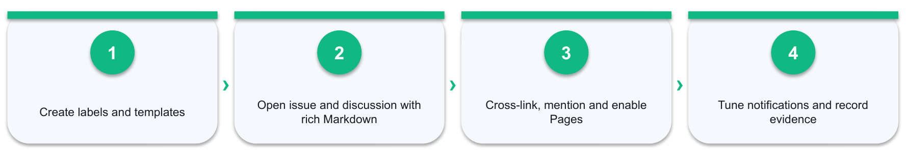

*Figure 8: Lab 08 workflow — Create labels and templates → Open issue and discussion with rich Markdown → Cross-link, mention and enable Pages → Tune notifications and record evidence*

#### Detailed procedure

1. **Action:** Create labels for bug, documentation, priority-high and good-first-issue.
   - **Why:** This action produces traceable evidence for the scenario and the mapped GH-900 objective.
   - **Record:** Enter the result, URL or screenshot reference, completion status, timestamp, and any reviewer note in row 5 of the Excel Evidence Log.
2. **Action:** Create an issue template or issue form for reproducible bugs.
   - **Why:** This action produces traceable evidence for the scenario and the mapped GH-900 objective.
   - **Record:** Enter the result, URL or screenshot reference, completion status, timestamp, and any reviewer note in row 6 of the Excel Evidence Log.
3. **Action:** Open a sample issue whose body uses GitHub-Flavored Markdown deliberately: a heading, bold and italic emphasis, a bulleted and a numbered list, a table, a block quote, a link and an image.
   - **Why:** This action produces traceable evidence for the scenario and the mapped GH-900 objective.
   - **Record:** Enter the result, URL or screenshot reference, completion status, timestamp, and any reviewer note in row 7 of the Excel Evidence Log.
4. **Action:** Add a fenced code block with a language identifier and confirm the syntax highlighting; add an inline `code` span and a - [ ] task list, then tick one item and observe the progress indicator.
   - **Why:** This action produces traceable evidence for the scenario and the mapped GH-900 objective.
   - **Record:** Enter the result, URL or screenshot reference, completion status, timestamp, and any reviewer note in row 8 of the Excel Evidence Log.
5. **Action:** Use a slash command such as /table or /code in a comment field and record what it inserted.
   - **Why:** This action produces traceable evidence for the scenario and the mapped GH-900 objective.
   - **Record:** Enter the result, URL or screenshot reference, completion status, timestamp, and any reviewer note in row 9 of the Excel Evidence Log.
6. **Action:** Assign the issue, label it and add it to a milestone.
   - **Why:** This action produces traceable evidence for the scenario and the mapped GH-900 objective.
   - **Record:** Enter the result, URL or screenshot reference, completion status, timestamp, and any reviewer note in row 10 of the Excel Evidence Log.
7. **Action:** In a comment, cross-link a second issue with #<number>, reference a commit by pasting its seven-character SHA, and confirm both render as autolinked references.
   - **Why:** This action produces traceable evidence for the scenario and the mapped GH-900 objective.
   - **Record:** Enter the result, URL or screenshot reference, completion status, timestamp, and any reviewer note in row 11 of the Excel Evidence Log.
8. **Action:** @mention yourself and, if the repository is in an organisation, a team, and explain how mention notifications differ from watching the repository.
   - **Why:** This action produces traceable evidence for the scenario and the mapped GH-900 objective.
   - **Record:** Enter the result, URL or screenshot reference, completion status, timestamp, and any reviewer note in row 12 of the Excel Evidence Log.
9. **Action:** Enable Discussions and open a Q&A discussion with a clear title, a category and an accepted-answer plan.
   - **Why:** This action produces traceable evidence for the scenario and the mapped GH-900 objective.
   - **Record:** Enter the result, URL or screenshot reference, completion status, timestamp, and any reviewer note in row 13 of the Excel Evidence Log.
10. **Action:** Configure repository watch settings and compare All activity, Participating and @mentions, Custom and Ignore subscriptions.
   - **Why:** This action produces traceable evidence for the scenario and the mapped GH-900 objective.
   - **Record:** Enter the result, URL or screenshot reference, completion status, timestamp, and any reviewer note in row 14 of the Excel Evidence Log.
11. **Action:** Create a saved reply for a common triage response and use it once.
   - **Why:** This action produces traceable evidence for the scenario and the mapped GH-900 objective.
   - **Record:** Enter the result, URL or screenshot reference, completion status, timestamp, and any reviewer note in row 15 of the Excel Evidence Log.
12. **Action:** Use global search and then a context search inside the repository with a qualifier such as is:issue label:bug, and record how the results differ.
   - **Why:** This action produces traceable evidence for the scenario and the mapped GH-900 objective.
   - **Record:** Enter the result, URL or screenshot reference, completion status, timestamp, and any reviewer note in row 16 of the Excel Evidence Log.
13. **Action:** Create a public or secret gist and compare it with a repository Wiki page.
   - **Why:** This action produces traceable evidence for the scenario and the mapped GH-900 objective.
   - **Record:** Enter the result, URL or screenshot reference, completion status, timestamp, and any reviewer note in row 17 of the Excel Evidence Log.
14. **Action:** Create docs/index.md on a branch, commit it and publish GitHub Pages from the selected branch/folder.
   - **Why:** This action produces traceable evidence for the scenario and the mapped GH-900 objective.
   - **Record:** Enter the result, URL or screenshot reference, completion status, timestamp, and any reviewer note in row 18 of the Excel Evidence Log.
15. **Action:** Verify the published Pages URL and record visibility implications.
   - **Why:** This action produces traceable evidence for the scenario and the mapped GH-900 objective.
   - **Record:** Enter the result, URL or screenshot reference, completion status, timestamp, and any reviewer note in row 19 of the Excel Evidence Log.
16. **Action:** Record URLs, screenshots, the rendered Markdown and the object-selection rationale in Excel.
   - **Why:** This action produces traceable evidence for the scenario and the mapped GH-900 objective.
   - **Record:** Enter the result, URL or screenshot reference, completion status, timestamp, and any reviewer note in row 20 of the Excel Evidence Log.

#### Acceptance criteria

- [ ] Issue is triaged
- [ ] Markdown features render as intended
- [ ] Cross-links and @mentions resolve
- [ ] Notification choice is justified
- [ ] Pages URL resolves

#### Reflection questions

1. Which GitHub object or control was the best fit, and why?
2. What evidence proves the final state rather than only the attempted action?
3. What would you change for an organisation or enterprise environment?

## Domain 04 — Apply Modern Development Practices (10–15%)

Actions · Copilot · Codespaces · dev containers · github.dev

### Core concepts

- **GitHub Actions:** Events trigger workflows made of jobs, steps, actions and runners.
- **Continuous feedback:** Automated checks shorten the gap between change and evidence.
- **GitHub Copilot:** AI-assisted suggestions, chat, agents and multi-model support accelerate work.
- **Plan differences:** Individual, Business and Enterprise plans add progressively stronger governance.
- **Codespaces:** Cloud development environments standardise compute and dependencies.
- **github.dev:** A lightweight browser editor; Codespaces provides a full runtime and terminal.

### Lab 09 — Build and Diagnose a GitHub Actions Check

**Objective:** Automate a repeatable pull-request validation and use run evidence to diagnose failure.

**Scenario:** Every documentation pull request must prove that README.md and SECURITY.md exist.

**Deliverable:** A pull-request Actions workflow with successful and failed run evidence

**Tools:** GitHub Actions, YAML, Git Bash, workflow logs, Excel workbook

#### Lab workflow

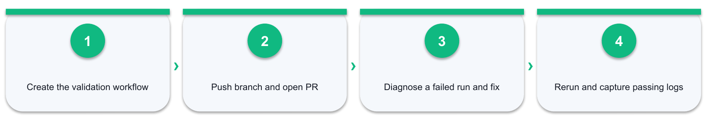

*Figure 9: Lab 09 workflow — Create the validation workflow → Push branch and open PR → Diagnose a failed run and fix → Rerun and capture passing logs*

#### Detailed procedure

1. **Action:** Inspect Actions workflow, event, job, step, action and runner relationships.
   - **Why:** This action produces traceable evidence for the scenario and the mapped GH-900 objective.
   - **Record:** Enter the result, URL or screenshot reference, completion status, timestamp, and any reviewer note in row 5 of the Excel Evidence Log.
2. **Action:** Create .github/workflows/validate.yml on a branch with pull_request and workflow_dispatch triggers.
   - **Why:** This action produces traceable evidence for the scenario and the mapped GH-900 objective.
   - **Record:** Enter the result, URL or screenshot reference, completion status, timestamp, and any reviewer note in row 6 of the Excel Evidence Log.
3. **Action:** Add checkout and shell-validation steps for README.md and SECURITY.md.
   - **Why:** This action produces traceable evidence for the scenario and the mapped GH-900 objective.
   - **Record:** Enter the result, URL or screenshot reference, completion status, timestamp, and any reviewer note in row 7 of the Excel Evidence Log.
4. **Action:** Commit and push the workflow branch, then open a pull request to trigger the run.
   - **Why:** This action produces traceable evidence for the scenario and the mapped GH-900 objective.
   - **Record:** Enter the result, URL or screenshot reference, completion status, timestamp, and any reviewer note in row 8 of the Excel Evidence Log.
5. **Action:** Inspect the run, job and step logs and record the commit SHA that the run evaluated.
   - **Why:** This action produces traceable evidence for the scenario and the mapped GH-900 objective.
   - **Record:** Enter the result, URL or screenshot reference, completion status, timestamp, and any reviewer note in row 9 of the Excel Evidence Log.
6. **Action:** Deliberately change the validation condition in a safe branch to produce one failed run.
   - **Why:** This action produces traceable evidence for the scenario and the mapped GH-900 objective.
   - **Record:** Enter the result, URL or screenshot reference, completion status, timestamp, and any reviewer note in row 10 of the Excel Evidence Log.
7. **Action:** Use the log evidence to correct the workflow and push a new commit.
   - **Why:** This action produces traceable evidence for the scenario and the mapped GH-900 objective.
   - **Record:** Enter the result, URL or screenshot reference, completion status, timestamp, and any reviewer note in row 11 of the Excel Evidence Log.
8. **Action:** Verify the pull request updates to a passing check and capture both run URLs.
   - **Why:** This action produces traceable evidence for the scenario and the mapped GH-900 objective.
   - **Record:** Enter the result, URL or screenshot reference, completion status, timestamp, and any reviewer note in row 12 of the Excel Evidence Log.
9. **Action:** Record trigger, job, failing step, diagnosis, correction and final status in Excel.
   - **Why:** This action produces traceable evidence for the scenario and the mapped GH-900 objective.
   - **Record:** Enter the result, URL or screenshot reference, completion status, timestamp, and any reviewer note in row 13 of the Excel Evidence Log.

#### Acceptance criteria

- [ ] Workflow triggers on PR
- [ ] Failure is diagnosed from logs
- [ ] Corrected run passes
- [ ] Run URLs and SHAs are captured

#### Reflection questions

1. Which GitHub object or control was the best fit, and why?
2. What evidence proves the final state rather than only the attempted action?
3. What would you change for an organisation or enterprise environment?

### Lab 10 — Compare Codespaces, github.dev and Copilot

**Objective:** Choose an appropriate cloud editing environment and verify AI-assisted output.

**Scenario:** A distributed contributor needs a consistent environment for a small documentation automation task.

**Deliverable:** A dev-container configuration, environment comparison and verified Copilot-assisted change

**Tools:** Codespaces, dev containers, github.dev, GitHub Copilot or trainer demonstration, Excel workbook

#### Lab workflow

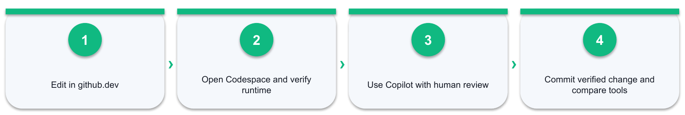

*Figure 10: Lab 10 workflow — Edit in github.dev → Open Codespace and verify runtime → Use Copilot with human review → Commit verified change and compare tools*

#### Detailed procedure

1. **Action:** Open the repository in github.dev and record which editing, source-control and terminal capabilities are available.
   - **Why:** This action produces traceable evidence for the scenario and the mapped GH-900 objective.
   - **Record:** Enter the result, URL or screenshot reference, completion status, timestamp, and any reviewer note in row 5 of the Excel Evidence Log.
2. **Action:** Create .devcontainer/devcontainer.json from an appropriate template or instructor-provided base.
   - **Why:** This action produces traceable evidence for the scenario and the mapped GH-900 objective.
   - **Record:** Enter the result, URL or screenshot reference, completion status, timestamp, and any reviewer note in row 6 of the Excel Evidence Log.
3. **Action:** Commit the configuration on a branch and create a Codespace from that branch.
   - **Why:** This action produces traceable evidence for the scenario and the mapped GH-900 objective.
   - **Record:** Enter the result, URL or screenshot reference, completion status, timestamp, and any reviewer note in row 7 of the Excel Evidence Log.
4. **Action:** Verify the terminal, repository branch, runtime and installed tools inside the Codespace.
   - **Why:** This action produces traceable evidence for the scenario and the mapped GH-900 objective.
   - **Record:** Enter the result, URL or screenshot reference, completion status, timestamp, and any reviewer note in row 8 of the Excel Evidence Log.
5. **Action:** Compare github.dev, Codespaces and a local Git Bash environment against editing, terminal, runtime and persistence needs.
   - **Why:** This action produces traceable evidence for the scenario and the mapped GH-900 objective.
   - **Record:** Enter the result, URL or screenshot reference, completion status, timestamp, and any reviewer note in row 9 of the Excel Evidence Log.
6. **Action:** Use Copilot or the trainer demonstration to explain or improve one small validation script.
   - **Why:** This action produces traceable evidence for the scenario and the mapped GH-900 objective.
   - **Record:** Enter the result, URL or screenshot reference, completion status, timestamp, and any reviewer note in row 10 of the Excel Evidence Log.
7. **Action:** Review the proposed output for correctness, security and fit; change at least one item based on human verification.
   - **Why:** This action produces traceable evidence for the scenario and the mapped GH-900 objective.
   - **Record:** Enter the result, URL or screenshot reference, completion status, timestamp, and any reviewer note in row 11 of the Excel Evidence Log.
8. **Action:** Commit the verified change, push it and capture environment plus AI-review evidence in Excel.
   - **Why:** This action produces traceable evidence for the scenario and the mapped GH-900 objective.
   - **Record:** Enter the result, URL or screenshot reference, completion status, timestamp, and any reviewer note in row 12 of the Excel Evidence Log.

#### Acceptance criteria

- [ ] Dev container is valid
- [ ] Environment choice is justified
- [ ] AI output is independently checked
- [ ] Verified change is committed

#### Reflection questions

1. Which GitHub object or control was the best fit, and why?
2. What evidence proves the final state rather than only the attempted action?
3. What would you change for an organisation or enterprise environment?

## Domain 05 — Manage Projects with GitHub (5–10%)

Projects · views · fields · workflows · milestones · insights

### Core concepts

- **One data model:** Issues, PRs and draft items can be viewed as table, board or roadmap.
- **Fields:** Status, iteration, priority and custom fields turn work into structured data.
- **Automation:** Built-in workflows update status as items open, close or merge.
- **Planning:** Milestones and iterations express target outcomes and timeboxes.
- **Communication:** Assignees and saved replies make ownership and responses consistent.
- **Insights:** Charts expose flow, workload, progress and bottlenecks.

### Lab 11 — Plan and Track a Release with GitHub Projects

**Objective:** Coordinate scope, ownership, timing and progress for a release.

**Scenario:** The CourseTrack Pro team needs one view of features, defects and release readiness.

**Deliverable:** A GitHub Project with table, board and roadmap views plus fields, workflows and insights

**Tools:** GitHub Projects, issues, milestones, labels, saved replies, Excel workbook

#### Lab workflow

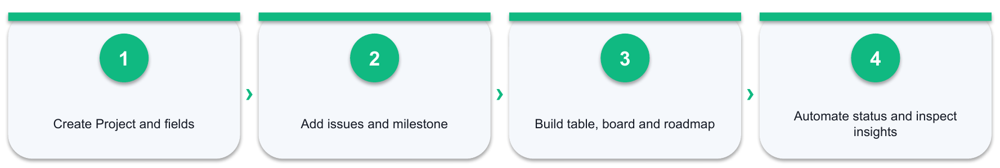

*Figure 11: Lab 11 workflow — Create Project and fields → Add issues and milestone → Build table, board and roadmap → Automate status and inspect insights*

#### Detailed procedure

1. **Action:** Create a project named CourseTrack Pro Release 1.1.
   - **Why:** This action produces traceable evidence for the scenario and the mapped GH-900 objective.
   - **Record:** Enter the result, URL or screenshot reference, completion status, timestamp, and any reviewer note in row 5 of the Excel Evidence Log.
2. **Action:** Add existing issues and pull requests and create two draft planning items.
   - **Why:** This action produces traceable evidence for the scenario and the mapped GH-900 objective.
   - **Record:** Enter the result, URL or screenshot reference, completion status, timestamp, and any reviewer note in row 6 of the Excel Evidence Log.
3. **Action:** Create Status, Priority, Iteration and Target date fields.
   - **Why:** This action produces traceable evidence for the scenario and the mapped GH-900 objective.
   - **Record:** Enter the result, URL or screenshot reference, completion status, timestamp, and any reviewer note in row 7 of the Excel Evidence Log.
4. **Action:** Configure table, board and roadmap views for different stakeholder questions.
   - **Why:** This action produces traceable evidence for the scenario and the mapped GH-900 objective.
   - **Record:** Enter the result, URL or screenshot reference, completion status, timestamp, and any reviewer note in row 8 of the Excel Evidence Log.
5. **Action:** Group or slice one view by owner, status or priority.
   - **Why:** This action produces traceable evidence for the scenario and the mapped GH-900 objective.
   - **Record:** Enter the result, URL or screenshot reference, completion status, timestamp, and any reviewer note in row 9 of the Excel Evidence Log.
6. **Action:** Configure a built-in workflow that moves closed items to Done.
   - **Why:** This action produces traceable evidence for the scenario and the mapped GH-900 objective.
   - **Record:** Enter the result, URL or screenshot reference, completion status, timestamp, and any reviewer note in row 10 of the Excel Evidence Log.
7. **Action:** Create a milestone and associate the release issues or pull requests.
   - **Why:** This action produces traceable evidence for the scenario and the mapped GH-900 objective.
   - **Record:** Enter the result, URL or screenshot reference, completion status, timestamp, and any reviewer note in row 11 of the Excel Evidence Log.
8. **Action:** Create an insight chart and interpret one bottleneck or workload imbalance.
   - **Why:** This action produces traceable evidence for the scenario and the mapped GH-900 objective.
   - **Record:** Enter the result, URL or screenshot reference, completion status, timestamp, and any reviewer note in row 12 of the Excel Evidence Log.
9. **Action:** Export the release inventory and observations into the Excel workbook.
   - **Why:** This action produces traceable evidence for the scenario and the mapped GH-900 objective.
   - **Record:** Enter the result, URL or screenshot reference, completion status, timestamp, and any reviewer note in row 13 of the Excel Evidence Log.

#### Acceptance criteria

- [ ] Three views answer different questions
- [ ] Fields are populated
- [ ] Workflow is enabled
- [ ] Insight is interpreted

#### Reflection questions

1. Which GitHub object or control was the best fit, and why?
2. What evidence proves the final state rather than only the attempted action?
3. What would you change for an organisation or enterprise environment?

## Domain 06 — Understand Privacy, Security and Administration (10–15%)

2FA · passkeys · roles · visibility · rulesets · EMU · policy

### Core concepts

- **Secure identity:** 2FA and passkeys reduce account-takeover risk.
- **Least privilege:** Repository and organisation roles should match responsibility.
- **Visibility:** Public, private and internal determine who can discover and access work.
- **Protected change:** Rulesets, branch protection, required reviews and checks guard critical branches.
- **Enterprise control:** EMUs and organisation policies centralise identity and Copilot governance.
- **Secure supply chain:** Dependabot, code scanning and secret scanning identify different risks.

### Lab 12 — Secure and Administer a Repository

**Objective:** Apply identity, access, branch and supply-chain controls to a repository.

**Scenario:** The release repository must prevent unsafe changes and surface security findings early.

**Deliverable:** A repository security baseline with authentication comparison, access rationale, ruleset design, CODEOWNERS and scanning evidence

**Tools:** Authentication settings, PAT and SSH key configuration, security settings, Dependabot, code scanning, secret scanning concepts, roles, rulesets, Excel workbook

#### Lab workflow

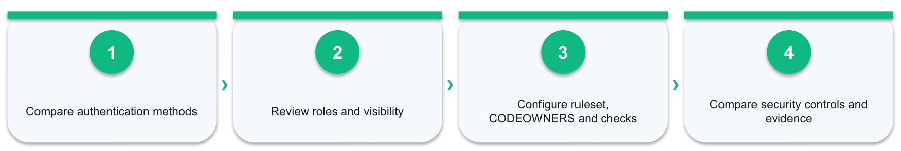

*Figure 12: Lab 12 workflow — Compare authentication methods → Review roles and visibility → Configure ruleset, CODEOWNERS and checks → Compare security controls and evidence*

#### Detailed procedure

1. **Action:** Run git remote -v on the training clone and identify whether the remote is HTTPS or SSH, and which credential each protocol requires.
   - **Why:** This action produces traceable evidence for the scenario and the mapped GH-900 objective.
   - **Record:** Enter the result, URL or screenshot reference, completion status, timestamp, and any reviewer note in row 5 of the Excel Evidence Log.
2. **Action:** Create a fine-grained personal access token scoped to the training repository with the minimum permissions, note its expiry, and record why username-and-password authentication is no longer accepted for Git operations.
   - **Why:** This action produces traceable evidence for the scenario and the mapped GH-900 objective.
   - **Record:** Enter the result, URL or screenshot reference, completion status, timestamp, and any reviewer note in row 6 of the Excel Evidence Log.
3. **Action:** Generate an SSH key with ssh-keygen -t ed25519, add the public key to the GitHub account, verify with ssh -T git@github.com and switch the remote with git remote set-url origin.
   - **Why:** This action produces traceable evidence for the scenario and the mapped GH-900 objective.
   - **Record:** Enter the result, URL or screenshot reference, completion status, timestamp, and any reviewer note in row 7 of the Excel Evidence Log.
4. **Action:** Compare classic PAT, fine-grained PAT, SSH key and deploy key on scope, expiry, revocation and best-fit use case, and state where a deploy key is preferable for a CI server. Never record any token or private key in the workbook.
   - **Why:** This action produces traceable evidence for the scenario and the mapped GH-900 objective.
   - **Record:** Enter the result, URL or screenshot reference, completion status, timestamp, and any reviewer note in row 8 of the Excel Evidence Log.
5. **Action:** Review the account's 2FA configuration and compare security keys, TOTP apps, SMS and passkeys on strength and recovery risk.
   - **Why:** This action produces traceable evidence for the scenario and the mapped GH-900 objective.
   - **Record:** Enter the result, URL or screenshot reference, completion status, timestamp, and any reviewer note in row 9 of the Excel Evidence Log.
6. **Action:** Confirm repository visibility and explain public, private and internal visibility boundaries.
   - **Why:** This action produces traceable evidence for the scenario and the mapped GH-900 objective.
   - **Record:** Enter the result, URL or screenshot reference, completion status, timestamp, and any reviewer note in row 10 of the Excel Evidence Log.
7. **Action:** Review collaborator or team roles and apply least-privilege reasoning to sample personas using the read, triage, write, maintain and admin levels.
   - **Why:** This action produces traceable evidence for the scenario and the mapped GH-900 objective.
   - **Record:** Enter the result, URL or screenshot reference, completion status, timestamp, and any reviewer note in row 11 of the Excel Evidence Log.
8. **Action:** Design or configure a main-branch ruleset requiring a pull request and status checks.
   - **Why:** This action produces traceable evidence for the scenario and the mapped GH-900 objective.
   - **Record:** Enter the result, URL or screenshot reference, completion status, timestamp, and any reviewer note in row 12 of the Excel Evidence Log.
9. **Action:** Add a CODEOWNERS file that assigns a reviewer to a documentation path and verify that a pull request touching that path requests the owner.
   - **Why:** This action produces traceable evidence for the scenario and the mapped GH-900 objective.
   - **Record:** Enter the result, URL or screenshot reference, completion status, timestamp, and any reviewer note in row 13 of the Excel Evidence Log.
10. **Action:** Add a .gitignore entry for a build or secret path, then demonstrate with git rm --cached why an already-tracked file keeps being committed until it is untracked.
   - **Why:** This action produces traceable evidence for the scenario and the mapped GH-900 objective.
   - **Record:** Enter the result, URL or screenshot reference, completion status, timestamp, and any reviewer note in row 14 of the Excel Evidence Log.
11. **Action:** Enable the dependency graph and Dependabot alerts where available, and distinguish alerts, security updates and version updates.
   - **Why:** This action produces traceable evidence for the scenario and the mapped GH-900 objective.
   - **Record:** Enter the result, URL or screenshot reference, completion status, timestamp, and any reviewer note in row 15 of the Excel Evidence Log.
12. **Action:** Configure Dependabot version updates using .github/dependabot.yml on a branch and review through a pull request.
   - **Why:** This action produces traceable evidence for the scenario and the mapped GH-900 objective.
   - **Record:** Enter the result, URL or screenshot reference, completion status, timestamp, and any reviewer note in row 16 of the Excel Evidence Log.
13. **Action:** Enable default code scanning setup or review the instructor demonstration, and note the difference between default and advanced setup and the push, pull_request and schedule triggers.
   - **Why:** This action produces traceable evidence for the scenario and the mapped GH-900 objective.
   - **Record:** Enter the result, URL or screenshot reference, completion status, timestamp, and any reviewer note in row 17 of the Excel Evidence Log.
14. **Action:** Review secret-scanning and push-protection behaviour without committing a real secret.
   - **Why:** This action produces traceable evidence for the scenario and the mapped GH-900 objective.
   - **Record:** Enter the result, URL or screenshot reference, completion status, timestamp, and any reviewer note in row 18 of the Excel Evidence Log.
15. **Action:** Add a SECURITY.md file describing how to report a vulnerability, and locate where a security advisory would be raised.
   - **Why:** This action produces traceable evidence for the scenario and the mapped GH-900 objective.
   - **Record:** Enter the result, URL or screenshot reference, completion status, timestamp, and any reviewer note in row 19 of the Excel Evidence Log.
16. **Action:** Compare organisation-owned accounts, Enterprise Managed Users and personal accounts.
   - **Why:** This action produces traceable evidence for the scenario and the mapped GH-900 objective.
   - **Record:** Enter the result, URL or screenshot reference, completion status, timestamp, and any reviewer note in row 20 of the Excel Evidence Log.
17. **Action:** Record control, threat, evidence, owner and residual risk in Excel.
   - **Why:** This action produces traceable evidence for the scenario and the mapped GH-900 objective.
   - **Record:** Enter the result, URL or screenshot reference, completion status, timestamp, and any reviewer note in row 21 of the Excel Evidence Log.

#### Acceptance criteria

- [ ] Authentication methods are compared with a chosen default
- [ ] Least privilege is justified
- [ ] Branch rule and CODEOWNERS are documented
- [ ] Security features are distinguished
- [ ] No real secret, token or key is recorded

#### Reflection questions

1. Which GitHub object or control was the best fit, and why?
2. What evidence proves the final state rather than only the attempted action?
3. What would you change for an organisation or enterprise environment?

## Domain 07 — Explore the GitHub Community (5–10%)

Open source · Sponsors · Marketplace · InnerSource · discovery

### Core concepts

- **Open source:** Shared licences and transparent collaboration compound public value.
- **Healthy contribution:** CONTRIBUTING, codes of conduct and issue templates set expectations.
- **Sustainability:** GitHub Sponsors helps fund maintainers and projects.
- **Discovery:** Follow users and organisations; use topics, stars and search to find work.
- **Marketplace:** Apps and Actions extend GitHub workflows.
- **InnerSource:** Open-source practices improve reuse and collaboration inside an organisation.

### Lab 13 — Contribute through a Fork and Explore the Community

**Objective:** Apply a safe fork contribution workflow and evaluate healthy community signals.

**Scenario:** A learner will propose a small documentation improvement to a training repository.

**Deliverable:** A fork, upstream remote, contribution branch and community-health evaluation

**Tools:** Forks, Git Bash, pull requests, licences, Sponsors, Marketplace, topics, Excel workbook

#### Lab workflow

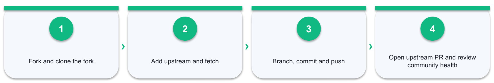

*Figure 13: Lab 13 workflow — Fork and clone the fork → Add upstream and fetch → Branch, commit and push → Open upstream PR and review community health*

#### Detailed procedure

1. **Action:** Select the approved training repository and read its README, licence, CONTRIBUTING and code of conduct.
   - **Why:** This action produces traceable evidence for the scenario and the mapped GH-900 objective.
   - **Record:** Enter the result, URL or screenshot reference, completion status, timestamp, and any reviewer note in row 5 of the Excel Evidence Log.
2. **Action:** Fork the repository and clone the learner-owned fork.
   - **Why:** This action produces traceable evidence for the scenario and the mapped GH-900 objective.
   - **Record:** Enter the result, URL or screenshot reference, completion status, timestamp, and any reviewer note in row 6 of the Excel Evidence Log.
3. **Action:** Run git remote -v, add the original repository as upstream and verify origin versus upstream.
   - **Why:** This action produces traceable evidence for the scenario and the mapped GH-900 objective.
   - **Record:** Enter the result, URL or screenshot reference, completion status, timestamp, and any reviewer note in row 7 of the Excel Evidence Log.
4. **Action:** Fetch upstream and create docs/improve-guide from the intended upstream branch.
   - **Why:** This action produces traceable evidence for the scenario and the mapped GH-900 objective.
   - **Record:** Enter the result, URL or screenshot reference, completion status, timestamp, and any reviewer note in row 8 of the Excel Evidence Log.
5. **Action:** Make a small documentation improvement, review it, commit it and push the branch to origin.
   - **Why:** This action produces traceable evidence for the scenario and the mapped GH-900 objective.
   - **Record:** Enter the result, URL or screenshot reference, completion status, timestamp, and any reviewer note in row 9 of the Excel Evidence Log.
6. **Action:** Open a pull request to upstream or stop before submission if the exercise repository requires trainer approval.
   - **Why:** This action produces traceable evidence for the scenario and the mapped GH-900 objective.
   - **Record:** Enter the result, URL or screenshot reference, completion status, timestamp, and any reviewer note in row 10 of the Excel Evidence Log.
7. **Action:** Explore topics, stars, followers, organisations, GitHub Sponsors and Marketplace.
   - **Why:** This action produces traceable evidence for the scenario and the mapped GH-900 objective.
   - **Record:** Enter the result, URL or screenshot reference, completion status, timestamp, and any reviewer note in row 11 of the Excel Evidence Log.
8. **Action:** Evaluate the repository's licence, contribution guidance, responsiveness and sustainability signals.
   - **Why:** This action produces traceable evidence for the scenario and the mapped GH-900 objective.
   - **Record:** Enter the result, URL or screenshot reference, completion status, timestamp, and any reviewer note in row 12 of the Excel Evidence Log.
9. **Action:** Explain how InnerSource reuses open-source practices behind organisational access controls.
   - **Why:** This action produces traceable evidence for the scenario and the mapped GH-900 objective.
   - **Record:** Enter the result, URL or screenshot reference, completion status, timestamp, and any reviewer note in row 13 of the Excel Evidence Log.
10. **Action:** Record remotes, branch, PR/draft URL and community evaluation in Excel.
   - **Why:** This action produces traceable evidence for the scenario and the mapped GH-900 objective.
   - **Record:** Enter the result, URL or screenshot reference, completion status, timestamp, and any reviewer note in row 14 of the Excel Evidence Log.

#### Acceptance criteria

- [ ] Origin/upstream are distinguished
- [ ] Contribution follows project guidance
- [ ] Branch is published to the fork
- [ ] Community signals are evaluated

#### Reflection questions

1. Which GitHub object or control was the best fit, and why?
2. What evidence proves the final state rather than only the attempted action?
3. What would you change for an organisation or enterprise environment?

### Lab 14 — Build a GH-900 Readiness Plan

**Objective:** Use evidence and weighted scores to close exam-readiness gaps by domain.

**Scenario:** The learner has completed the practical work and needs a targeted final revision plan.

**Deliverable:** A weighted GH-900 readiness dashboard and two-day revision plan

**Tools:** Official Microsoft practice assessment, Tertiary practice exam, Excel readiness dashboard

#### Lab workflow

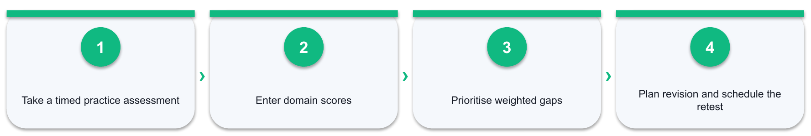

*Figure 14: Lab 14 workflow — Take a timed practice assessment → Enter domain scores → Prioritise weighted gaps → Plan revision and schedule the retest*

#### Detailed procedure

1. **Action:** Complete the official Microsoft practice assessment under timed, distraction-free conditions.
   - **Why:** This action produces traceable evidence for the scenario and the mapped GH-900 objective.
   - **Record:** Enter the result, URL or screenshot reference, completion status, timestamp, and any reviewer note in row 5 of the Excel Evidence Log.
2. **Action:** Complete the Tertiary practice exam and record the date, mode and total score.
   - **Why:** This action produces traceable evidence for the scenario and the mapped GH-900 objective.
   - **Record:** Enter the result, URL or screenshot reference, completion status, timestamp, and any reviewer note in row 6 of the Excel Evidence Log.
3. **Action:** Enter each domain score in the Excel Exam Readiness sheet.
   - **Why:** This action produces traceable evidence for the scenario and the mapped GH-900 objective.
   - **Record:** Enter the result, URL or screenshot reference, completion status, timestamp, and any reviewer note in row 7 of the Excel Evidence Log.
4. **Action:** Review the weighted priority calculation and identify the top three revision domains.
   - **Why:** This action produces traceable evidence for the scenario and the mapped GH-900 objective.
   - **Record:** Enter the result, URL or screenshot reference, completion status, timestamp, and any reviewer note in row 8 of the Excel Evidence Log.
5. **Action:** Link each weak objective to a relevant slide, Learner Guide section and lab evidence item.
   - **Why:** This action produces traceable evidence for the scenario and the mapped GH-900 objective.
   - **Record:** Enter the result, URL or screenshot reference, completion status, timestamp, and any reviewer note in row 9 of the Excel Evidence Log.
6. **Action:** Redo at least one command or configuration task from each priority domain without copying the previous procedure.
   - **Why:** This action produces traceable evidence for the scenario and the mapped GH-900 objective.
   - **Record:** Enter the result, URL or screenshot reference, completion status, timestamp, and any reviewer note in row 10 of the Excel Evidence Log.
7. **Action:** Write a two-day study plan with specific objectives, activities and retest times.
   - **Why:** This action produces traceable evidence for the scenario and the mapped GH-900 objective.
   - **Record:** Enter the result, URL or screenshot reference, completion status, timestamp, and any reviewer note in row 11 of the Excel Evidence Log.
8. **Action:** Confirm the booking, personal Microsoft account, accepted ID and exam-environment requirements.
   - **Why:** This action produces traceable evidence for the scenario and the mapped GH-900 objective.
   - **Record:** Enter the result, URL or screenshot reference, completion status, timestamp, and any reviewer note in row 12 of the Excel Evidence Log.
9. **Action:** Schedule the next timed practice only after targeted revision and record the new result.
   - **Why:** This action produces traceable evidence for the scenario and the mapped GH-900 objective.
   - **Record:** Enter the result, URL or screenshot reference, completion status, timestamp, and any reviewer note in row 13 of the Excel Evidence Log.

#### Acceptance criteria

- [ ] Domain scores are entered
- [ ] Priorities use weighted gaps
- [ ] Study plan links to hands-on evidence
- [ ] Exam-day requirements are confirmed

#### Reflection questions

1. Which GitHub object or control was the best fit, and why?
2. What evidence proves the final state rather than only the attempted action?
3. What would you change for an organisation or enterprise environment?

## Exam preparation

- Exam: GH-900 GitHub Foundations
- Fee: US$99 (regional pricing may apply)
- Exam time: 100 minutes
- Official credential page: https://learn.microsoft.com/en-us/credentials/certifications/github-foundations/
- Tertiary practice exam: https://exams.tertiaryinfotech.com/practice-exams/github/github-foundations

Use the Lab 14 Exam Readiness sheet to enter practice scores. Prioritise domains with both high weighting and a large score gap. Retake practice only after targeted revision.

## Glossary

- **Repository:** A version-controlled project and its history.
- **Working tree:** The checked-out files that you can edit.
- **Staging area / index:** The selected content prepared for the next commit.
- **Commit:** A named snapshot with author, time, message, tree and parent reference.
- **HEAD:** The reference that identifies the currently checked-out commit or branch.
- **Branch:** A movable pointer to a line of commits.
- **Remote-tracking branch:** A local reference such as origin/main that records the last fetched remote state.
- **Fetch:** Update remote-tracking references without integrating them into the current branch.
- **Pull:** Fetch remote work and integrate it into the current branch.
- **Push:** Publish local commits to a remote branch.
- **Merge conflict:** A change overlap that requires a person to choose the final content.
- **Pull request:** A proposal to merge one branch into another with review context.
- **Issue:** A tracked unit of work, feedback or defect.
- **Workflow:** An event-driven GitHub Actions automation definition.
- **Runner:** The machine that executes an Actions job.
- **Ruleset:** A centrally managed set of repository or branch rules.
- **Fork:** A repository copy under another account for independent contribution.
- **InnerSource:** Open-source collaboration practices applied within an organisation.
